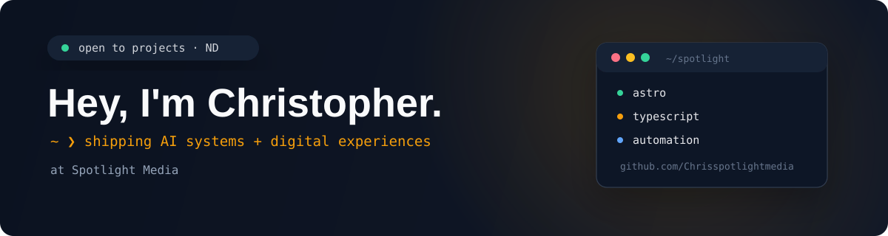

  

<h1 align="center">Hey, I'm Christopher</h1>

  <strong>AI Systems & Automation Lead at <a href="https://github.com/Spotlight-Media-Fargo">Spotlight Media</a></strong>

I build AI-assisted websites, internal tools, and automations at Spotlight Media, from client websites and our internal CMS to analytics, SEO integrations, and workflows that save the team time.

My focus is turning client needs and business ideas into reliable, easy-to-use tools and websites, while helping our team put AI to work in practical ways.

## What I work on

- Building and launching AI-assisted client websites from design through deployment
- Developing Spotlight’s internal CMS, dashboards, and website management tools
- Connecting forms, analytics, SEO tools, databases, and third-party services
- Managing hosting, domains, security, and website performance
- Researching AI tools and helping the team apply them to everyday work

## Technical stack

### Frontend

### Backend & data

### Delivery & automation

## Find me

---

**Build clearly. Automate thoughtfully. Keep the spotlight on the work.**

